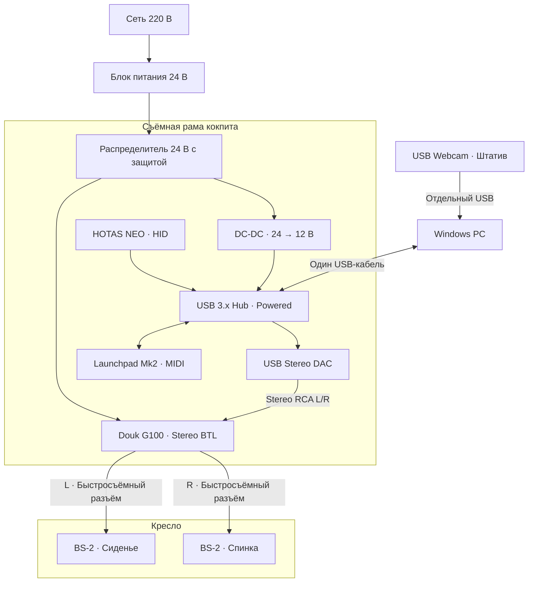
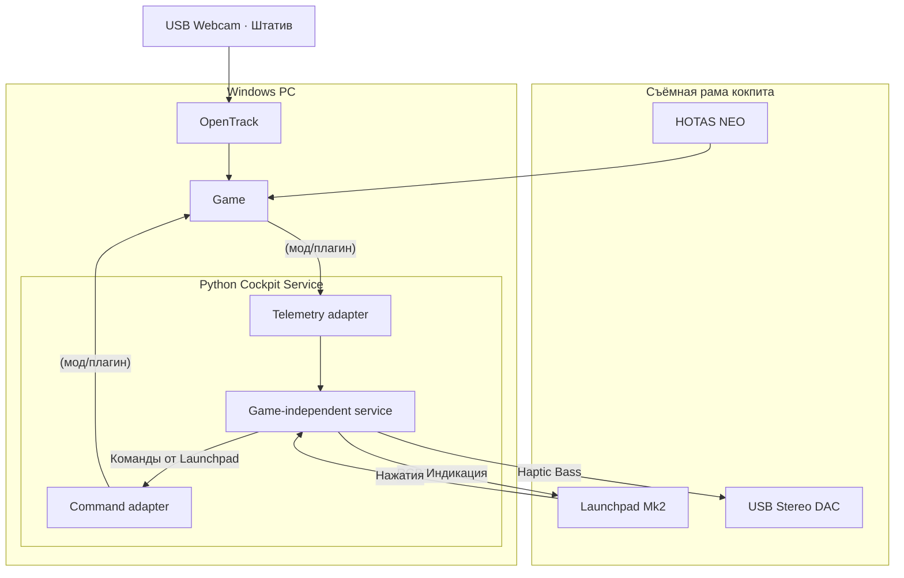

# DIY Flight Cockpit — план проекта

## 1. Цель

Создать компактный домашний кокпит для **Ace Combat 8, X4: Foundations** и других авиакосмических симуляторов на ПК.

Основные возможности:

- Эргономичное управление через HOTAS Thrustmaster NEO.
- Программируемая RGB-панель управления на Novation Launchpad Mk2.
- Двухканальная тактильная отдача через bass shakers в сиденье и спинке.
- Единая программная система управления периферией на Python.
- Отслеживание движений головы через веб-камеру.

**Принцип:** максимум иммерсивности при минимальных затратах, с использованием готовой электроники, 3D-печати и простых механических конструкций. Без изготовления собственных усилителей и контроллеров там, где существуют готовые решения.

"Кокпит" должен быть относительно быстро съемным (со стула), и по возможности подключаться к ПК одним проводом (не считая веб-камеры) на "раме" кокпита смонтирован и usb hub (HOTAS + usb audio + launchpad), и звук (douk g100 + shakers), в компьютер идет один провод (usb 3 хаб) + опционально питание кокпита.

## 2. Принципиальная схема подключения и крепления

## 3. Приниципиальная программная схема

## 4. Bill of Materials (BOM)

### Имеющееся оборудование

| Компонент | Назначение |
|---|---|
| Thrustmaster T.Flight HOTAS NEO | Управление полётом |
| Novation Launchpad Mk2 | Программируемая панель 8×8 RGB |
| Full HD USB-веб-камера | Head tracking |
| ПК Windows | Игры и программная интеграция |
| Кресло TopChairs Vertus | Несущая конструкция кокпита |

### Электроника — приобрести

| Компонент | Кол-во | Примечание |
|---|---:|---|
| Douk Audio BS-2, 4 Ом, 30 Вт | 2 | Сиденье и спинка |
| Douk Audio G100 | 1 | Двухканальный усилитель, режим BTL |
| Блок питания G100, 24 В | 1 |  |
| Понижающий преобразователь для usb-хаба | 1 |  |
| USB Stereo DAC | 1 | Независимый аудиовыход ПК |
| Кабель 3,5 мм → 2 RCA | 1 | DAC → G100 |
| Акустический провод 2×0,75–1,5 мм² | 2 линии | G100 → BS-2 |
| USB-хаб | 1 | Подключение устройств к ПК |

### Механика — приобрести/изготовить

- базовый "фундамент" (алюминиевый профиль) - фиксированое НЕ съемное крепление к днищу сиденья вместо выдвижной подставки для ног
- съемная основная рама (электроние + звук + hotas + launchpad)
    * рама до уровня подлокотников - профиль
    * отдельные крепления и фиксаторы - 3d печать (L-образная панель-подложка launchpad и пр.)
    * крепление между рамой и фундаментом - 2 струбцины/эксцентриковых зажима? или что-то другое быстро съемное
- кабель менеджмент

## 5. Инструменты и методы

- FreeCAD
- Python 3.12 (Cockpit Service; MIDI через Mido + python-rtmidi)

## 6. ПЛАН

### Этап 1

Управление, без звука:

- механика креплений к креслу
- все работает через 1 usb хаб + 1 провод питания
- hotas работает
- есть rgb индикация на launchpad
- работают какие-то базовые команды с клавиш launchpad
